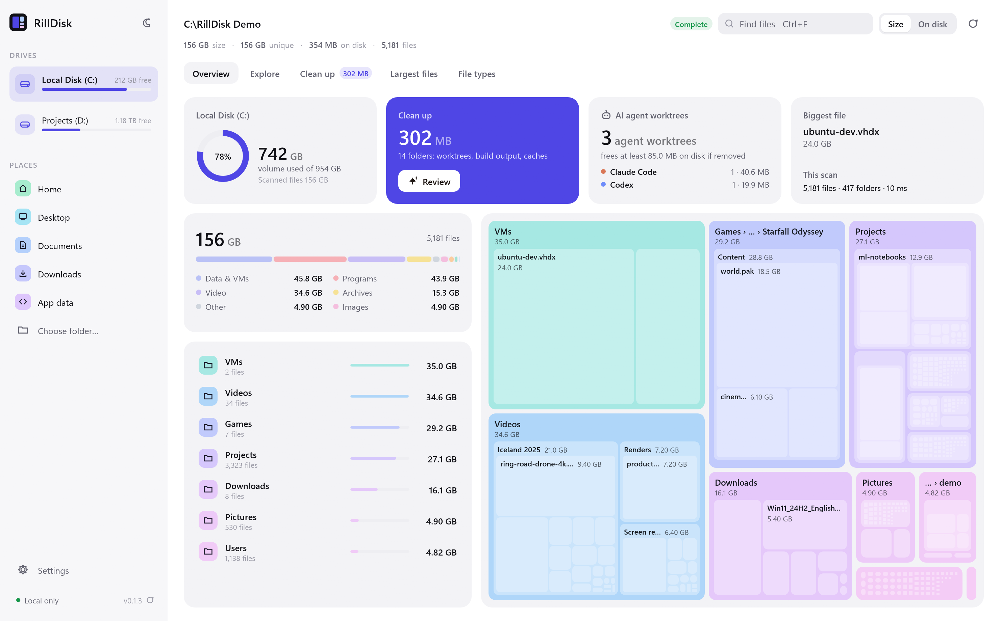

  

**RillDisk {version}**: see what fills your disks and what you can safely free. A native app, a CLI and an MCP server for AI assistants, built in Rust. It reads file metadata; an optional Git check runs your own `git` read-only. Nothing is uploaded or deleted behind your back.

