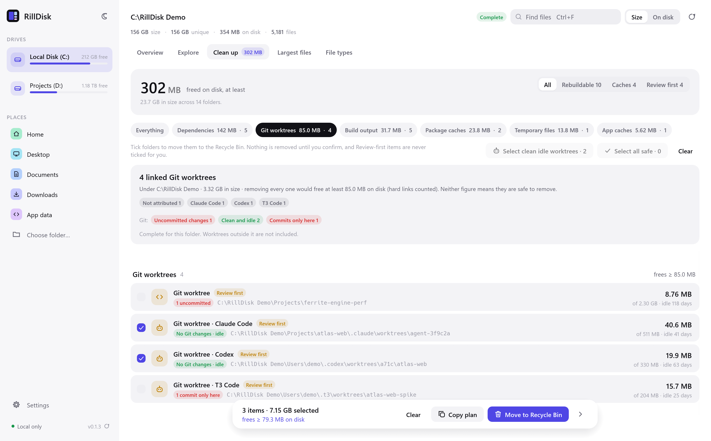
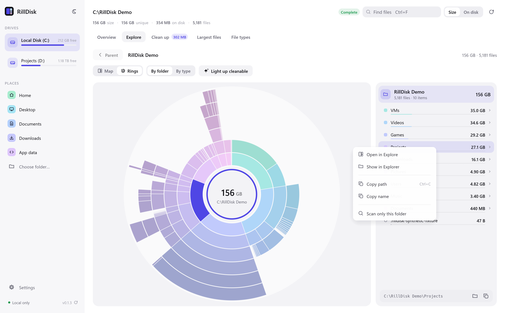

<div align="center">


# RillDisk

**See where your disk went, and what you can safely get back.**
A native disk analyzer for Windows, Linux and macOS that knows what coding agents
leave behind, with a CLI and an MCP server built on the same engine.

[](LICENSE)


[](https://github.com/lord007tn/rilldisk/actions/workflows/ci.yml)

[Download](https://github.com/lord007tn/rilldisk/releases/latest) ·
[Git worktrees](#git-worktrees) ·
[Clean up safely](#clean-up-safely) ·
[AI assistants](#ai-assistants-mcp) ·
[Known limits](#known-limits)


<sub>The app's own scripted tour (<code>--tour video</code>) on a synthetic disk from
<code>scripts/make_demo_fixture.py</code>: invented paths and drives, real Git
repositories, Git's own verdicts. Frames play at a fixed rate, not in real time.
<a href="docs/media/tour.mp4">Captioned MP4 (39 s)</a>.</sub>

</div>

## What it does

* **Shows where space went.** A GPU-drawn treemap and a sunburst, a folder list,
  the largest files and space by file type. Right-click any folder or file to show
  it in Explorer (Finder, or your file manager), copy its path or scan just that folder.
* **Finds what can go.** `node_modules`, `target`, `.next`, `.venv`, Unity
  `Library`, package caches, temp folders and Git worktrees, including the ones
  Claude Code, Codex, T3 Code, Cursor and Conductor create. Each candidate has a
  safety class, a reason, idle time, a suggested command, and the space removing
  it would actually free once hard links are counted.
* **Asks Git about worktrees.** Uncommitted changes, commits that exist only in that
  worktree, locks and the last commit, from your own `git`, read-only.
* **Removes only what you confirm.** Ticked folders go to the Recycle Bin / Trash
  after a confirmation that lists every path. Every folder is checked again right
  before it is moved.
* **Works from scripts and AI assistants.** A CLI with JSON output and a local
  stdio MCP server that can scan and explain but never delete.

<table>
<tr>
<td width="50%"></td>
<td width="50%"></td>
</tr>
<tr>
<td><b>Overview</b>: the drive, what you can get back and where the space went.</td>
<td><b>Git worktrees</b>: counts, scope, size against what removal frees, and Git's verdict for each.</td>
</tr>
<tr>
<td></td>
<td></td>
</tr>
<tr>
<td><b>Explore</b>: nested map beside the folder list.</td>
<td><b>Right-click</b>: Show in Explorer, copy, or scan one folder.</td>
</tr>
</table>

## Install

Download from the [latest release](https://github.com/lord007tn/rilldisk/releases/latest):

| System | Package | Notes |
| --- | --- | --- |
| Windows 10/11 (x64, ARM64) | `RillDisk-<version>-x64.msi` / `-arm64.msi` | Start menu entry, `rilldisk` on PATH, clean uninstall |
| | `rilldisk-<tag>-<arch>-pc-windows-msvc.zip` | Portable, no admin rights |
| macOS 11+ (Apple silicon, Intel) | `RillDisk-<version>-arm64.dmg` / `-x64.dmg` | Drag to Applications |
| Debian, Ubuntu and derivatives | `rilldisk_<version>_amd64.deb` (also arm64) | `sudo apt install ./rilldisk_<version>_amd64.deb` |
| Fedora, RHEL, openSUSE | `rilldisk-<version>-1.x86_64.rpm` (also aarch64) | `sudo dnf install ./…rpm` |
| Any Linux desktop | `RillDisk-<version>-x86_64.AppImage` / `-aarch64` | `chmod +x`, run |
| Servers, containers | `rilldisk-<tag>-<arch>-unknown-linux-musl.tar.gz` | Static CLI and MCP server |

Every release has `SHA256SUMS` and GitHub build attestations. Builds are not
code-signed or notarized yet, so SmartScreen and Gatekeeper may ask you to confirm
the first launch. Steps, verification and uninstalling:
[docs/INSTALL.md](docs/INSTALL.md).

Each package holds `rilldisk-desktop` (the app) and `rilldisk` (CLI and MCP server).
No account, and no administrator rights are needed to scan.

**Upgrading.** The desktop checks GitHub for a newer release once a day if you
allow it, and offers it on an update card; nothing is installed until you click
**Update and restart**. Click the version at the bottom of the sidebar to check
now. Windows MSI copies download and verify the new MSI, then Windows Installer
upgrades after you consent; `.zip` and `.tar.gz` copies are replaced in place
after a SHA-256 check (`rilldisk update` does the same from a terminal).
Copies installed from a `.deb`, `.rpm`, AppImage or `.dmg` get a link to the new
package instead. `RILLDISK_NO_UPDATE_CHECK=1` turns every check off
([how updates work](docs/proposals/updates.md)).

## Git worktrees

Removing a linked worktree folder never deletes commits: they are stored in the
main repository and its branch stays. What can be lost is **uncommitted work**
(changed, staged or untracked files) and **commits made on a detached HEAD** that no
branch, tag or remote holds. RillDisk asks your installed `git` about exactly that,
read-only, and gives each worktree a verdict:

| Verdict | Meaning |
| --- | --- |
| Uncommitted changes | Git reports changed or untracked files that removal would lose |
| Commits only here | A detached HEAD holds commits nothing else does |
| Locked | Someone ran `git worktree lock` |
| Active | No Git-reported changes, but commits or file changes within the idle threshold |
| Clean and idle | No Git-reported changes, nothing only there, and idle for the threshold (14 days by default) |
| Unknown | Git is missing, timed out or could not read the repository; never treated as clean |

Each verdict comes with the next step to take (commit or stash, make a branch,
unlock, or `git worktree remove`). Worktrees stay **Review first** whatever Git says,
because Git cannot see everything:

* **Ignored files** (`.env`, local settings, scratch files) are not reported by
  `git status`.
* **A running agent** is not detected. An idle time only says nothing changed for a
  while.
* **"Not on any remote"** uses your remote-tracking branches as of your last fetch;
  RillDisk never fetches.

In the desktop the check runs in the background after a scan (Settings can turn it
off or change the idle threshold). **Select clean idle worktrees** ticks only clean
and idle ones. Right before a worktree is removed, Git is asked again, and the
worktree is skipped if Git now reports changes, a lock, commits only there, new
activity since it was judged idle, or cannot answer.

```text
> rilldisk reclaim D:\code --git --min-size 1MB
      SIZE       FREES  SAFETY         IDLE  KIND                       PATH
  12.0 MiB    12.0 MiB  Review first     0d  Git worktree               D:\code\atlas-web\.claude\worktrees\add-search
                        git: Uncommitted changes - 1 changed file and 1 untracked item would be lost; last work today; branch add-search (no remote; kept in the repository).
  12.0 MiB    12.0 MiB  Review first    25d  Git worktree               D:\code\atlas-web\.claude\worktrees\spike-cache
                        git: Commits only here - 1 commit on a detached HEAD exists nowhere else; last work 25 days ago; detached HEAD.
  12.0 MiB    12.0 MiB  Review first    41d  Git worktree               D:\code\atlas-web\.claude\worktrees\fix-login
                        git: Clean and idle - No changes Git reports (ignored files are not checked); last work 41 days ago; branch fix-login (no remote; kept in the repository).
```

<sub>From a synthetic test repository; suggested commands omitted.</sub>

The CLI asks Git only with `--git` (`--stale-days N` sets the threshold; JSON gains
`candidates[].git`). With `--git --delete`, worktrees that Git did not report as
clean, including unknown ones, are left out. The MCP server never runs Git.
Folders left in an agent's `worktrees` directory without a `.git` are listed as
*orphaned agent folders*: Git no longer knows them, so there is nothing to ask.
Exact commands and safeguards: [docs/proposals/git-inspection.md](docs/proposals/git-inspection.md).

## Clean up safely

| Safety | Meaning | Examples |
| --- | --- | --- |
| Regenerable | Rebuilt from source by project tooling | `node_modules`, `target`, `.next`, `bin`/`obj`, `__pycache__`, `.venv`, Unity `Library` |
| Cache | Re-downloaded or recreated on demand | npm, pnpm, pip, uv, Cargo, NuGet and Gradle caches, temp folders, shader caches |
| Review first | May hold unique work | Git worktrees, orphaned agent folders, Recycle Bin / Trash, model downloads |

Candidates are recognised from names and marker files (`target` beside
`Cargo.toml`, a `.git` *file*, `pyvenv.cfg`), never by reading file contents.
**SIZE** is what the folder holds; **FREES** is what removing it frees on disk:
allocated space, without files hard-linked elsewhere in the scan (pnpm and Cargo
hard-link a lot, and sparse or compressed files take less than their length, so
the two can differ greatly; scan the whole drive for the most accurate figure).
The desktop's Size / On disk switch changes the size figures; what removal frees
is always on disk. It reads "at least" only when every allocation is known, and
"about" when some sizes fell back to file length.

**Clean up** has two halves: **Safe to delete** (Regenerable and Cache folders that
tools rebuild or re-download) and **Review first** (folders that may hold unique
work, such as worktrees). One **All kinds** menu narrows either half to one kind.
Tick folders, tick a kind's heading, or press **Select all safe**; Review-first
items are never ticked for you, and empty folders are not listed. **Move to Recycle Bin** opens a
confirmation listing every path and the total. Right before each folder is moved,
RillDisk checks again that it:

* is still a real folder at the same place, not a link or junction, with no link above it;
* is the same folder the scan found, not a different one created at that path since;
* is not a drive root, mount point, your home folder, a system folder or the scan root;
* for Git-checked worktrees, still has no Git-reported changes (see above).

Anything that fails is skipped and reported. Permanent deletion is a separate,
explicit choice. RillDisk never runs `git worktree prune`; the result tells you
when to. From a terminal, `rilldisk reclaim <path> --delete` lists what it would
move and asks first (`--safety` picks classes, `--permanent`, `--yes`,
`--format json`). Rules and threat model: [docs/proposals/cleanup.md](docs/proposals/cleanup.md).

## AI assistants (MCP)

`rilldisk mcp --root <folder>` is a local stdio MCP server confined to the roots you
give it. The desktop's home page detects Claude Code, Claude Desktop, Codex CLI,
Cursor, VS Code, Windsurf, Gemini CLI, Zed, OpenCode and Cline, shows the exact
config change before writing it (with a backup), and checks the connection
(`rilldisk mcp setup` and `rilldisk mcp doctor` do the same from a terminal).

| Tool | What it does |
| --- | --- |
| `allowed_roots` | Configured scope and limits |
| `start_scan`, `scan_status`, `cancel_scan` | Background scan with progress; partial results stay queryable |
| `query_entries` | Children, largest files or path search, paginated |
| `find_reclaimable` | Cleanup candidates with safety, reason, idle days and suggested command |
| `file_types` | Space by extension |

There is no delete, move, shell, Git or content-read tool: your assistant proposes,
you decide. See [docs/MCP.md](docs/MCP.md).

## CLI

```powershell
rilldisk drives                                  # capacity and free space
rilldisk scan D:\ --top 30                       # largest files
rilldisk scan D:\ --format jsonl -o inventory.jsonl
rilldisk reclaim $HOME --git --format json       # candidates with Git verdicts
```

Exit status: `0` complete, `2` partial, `130` cancelled, `1` failure. Output files
must be new; existing files are never overwritten.

## Privacy and network

* **Read:** file and folder names, sizes, dates and attributes. File contents are
  never opened by RillDisk. The Git check runs your `git`, which reads repository
  metadata and compares working files as `git status` always does.
* **Network:** only the update check (GitHub release feed), which you can turn off.
  No telemetry, no accounts, no listening port.
* **Programs started:** `git` (read-only commands, when Git checks are on or `--git`
  is given) and your file manager (only when you choose Show in Explorer:
  [scope](docs/proposals/reveal.md)). Never a shell.
* **Changes:** only the folders you confirm, to the Recycle Bin / Trash by default.
  RillDisk never elevates on its own ([protected folders](docs/proposals/elevation.md)).

## Known limits

* **Entry limit.** A scan holds as many entries as fit in half of the installed
  memory (about 240 bytes each), never fewer than 30 million: about 35 million on
  a 16 GB computer, 140 million on 64 GB. A scan that reaches it is marked
  incomplete everywhere, and the desktop offers a rescan with a larger limit
  (memory permitting); the CLI and MCP server take `--max-entries`. Counts from an incomplete scan, including worktree counts,
  are lower bounds.
* **Partial scans** (unreadable folders, cancellation, unresponsive folders) are
  marked partial in the app, the CLI exit code, JSON and MCP. Protected system
  folders need administrator rights (desktop: **Restart as administrator**).
* **Sizes** are file allocations, not volume usage: filesystem metadata, alternate
  streams and snapshots are excluded. Scans are live, not atomic snapshots.
* **Folder identity** for cleanup is recorded when candidates are found, right
  after the scan; a folder swapped in during the scan itself is not detected.
* **Git checks** see what `git status` sees: not ignored files, not running
  processes, and remote state only as of your last fetch.
* **Platforms.** Windows is the primary platform. Linux and macOS builds are built
  and tested in CI; macOS performance has not been measured. Builds are unsigned.

Measured scan times and memory: [docs/PERFORMANCE.md](docs/PERFORMANCE.md).

## Build from source

Rust stable plus, on Windows, Visual Studio C++ Build Tools and the Windows SDK
(`rc.exe` embeds the icon and manifest; set `RC_PATH` if it is not found). Linux
needs `pkg-config libxkbcommon-dev libwayland-dev libx11-dev`.

```powershell
cargo build --release --locked
cargo fmt --all -- --check
cargo clippy --workspace --all-targets --locked -- -D warnings
cargo test --workspace --locked
python scripts/test_mcp.py target/release/rilldisk.exe
```

Demo media is reproducible and synthetic:

```powershell
python scripts/make_demo_fixture.py "C:\RillDisk Demo"          # ~150 GB of sparse files; real Git worktrees if git is installed
target\release\rilldisk-desktop.exe "C:\RillDisk Demo" --capture shots            # screenshots
target\release\rilldisk-desktop.exe "C:\RillDisk Demo" --capture video --tour video
python scripts/make_demo_video.py video --ffmpeg <ffmpeg> --mp4 tour.mp4 --gif tour.gif
```

Five crates: `rilldisk-core` (scanner, accounting, reclaim rules, cleanup, Git
inspection), `rilldisk` (CLI and MCP), `rilldisk-desktop` (egui and wgpu),
`rilldisk-update` (the only network code) and `rilldisk-mcp-setup`. See
[architecture](docs/ARCHITECTURE.md), [CONTRIBUTING.md](CONTRIBUTING.md) and
[SECURITY.md](SECURITY.md).

## License

Copyright © 2026 Raed Bahri and RillDisk contributors. Licensed under the
[GNU Affero General Public License v3.0 only](LICENSE).
