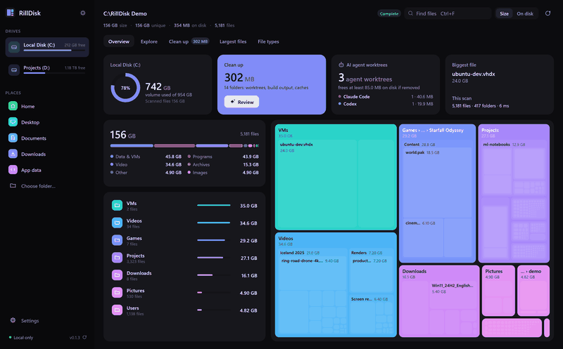
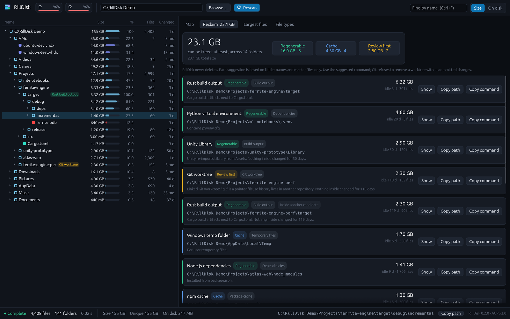
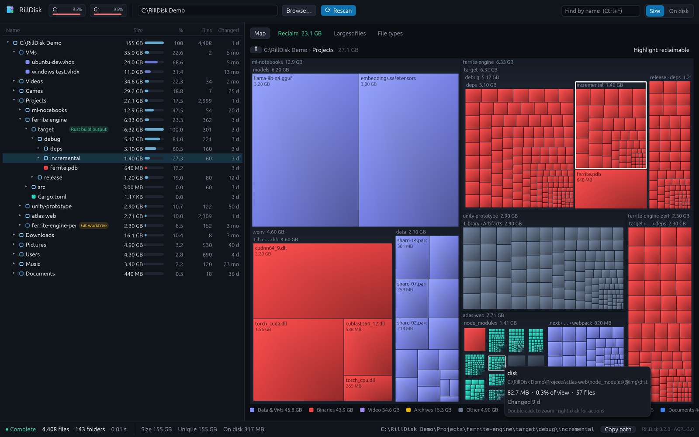
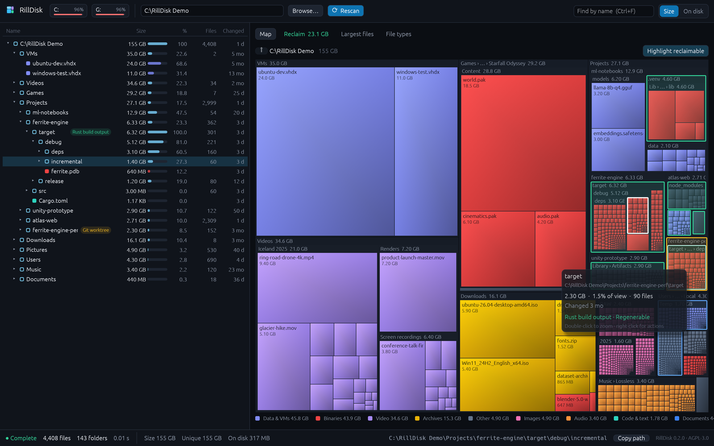
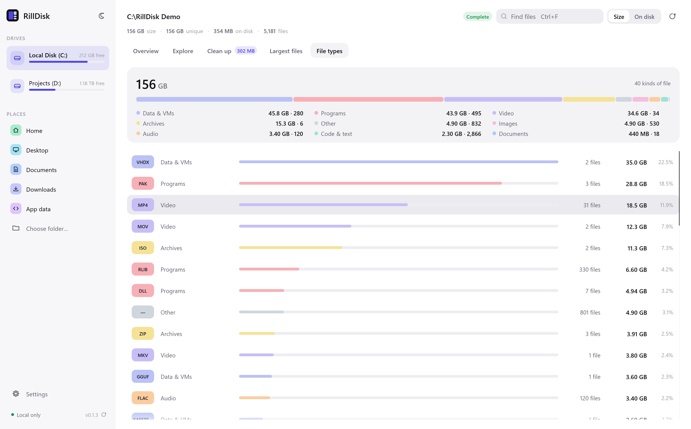

<div align="center">


# RillDisk

**See where your disk went — and what you can safely get back.**
A native, GPU-rendered disk analyzer for Windows, with a CLI and an MCP server so
your AI assistant sees exactly what you see.

[](LICENSE)


[](https://github.com/lord007tn/rilldisk/actions/workflows/ci.yml)

[Download](https://github.com/lord007tn/rilldisk/releases) ·
[Reclaim space](#reclaim-space-without-guesswork) ·
[For AI assistants](#give-your-ai-assistant-the-same-view) ·
[Performance](#performance) ·
[Roadmap](ROADMAP.md)



<sub>Recorded by the app's own scripted tour on a synthetic demo disk (<code>scripts/make_demo_fixture.py</code>). No real user data.</sub>

</div>

## Why RillDisk

|  |  |
| --- | --- |
| **Fast and lean** | Batched Win32 metadata enumeration on a barrier-free, work-stealing pipeline. A 3.1-million-file developer workspace scans in **5–9 s** using ~560 MB; a whole 30-million-entry system drive in about 3 minutes ([numbers](#performance)). |
| **A map, not a list** | Squarified, cushion-shaded treemap rendered on the GPU (wgpu). Hover, click, zoom, breadcrumb back out. Folder chains like `SteamLibrary › … › common` fold into one header. |
| **Reclaim, explained** | Finds Git worktrees (including forgotten **AI-agent worktrees**), `node_modules`, `target`, `.next`, `.venv`, Unity `Library`, package caches and temp folders — each with a safety level, reason, idle time, the exact command to run, and how much space it **really** frees once hard links are accounted for. |
| **Built for agents too** | The same engine powers a CLI with JSON output and a local **MCP server**. Claude Code, Codex, Cursor or any MCP client can scan, query and explain your disk. |
| **Read-only by design** | Metadata only. Never opens, uploads or deletes files. No telemetry, no network listener, no elevation. |
| **Open source** | AGPL-3.0-only, pure Rust: no Electron, no Tauri, no webview, no JavaScript. |

<table>
<tr>
<td width="50%"></td>
<td width="50%"></td>
</tr>
<tr>
<td><b>Reclaim</b> — what you can free, grouped by how safe it is to remove.</td>
<td><b>Zoom</b> — double-click any block; hover for size, share, file count and age.</td>
</tr>
<tr>
<td></td>
<td></td>
</tr>
<tr>
<td><b>Highlight reclaimable</b> — outlines every candidate directly on the map.</td>
<td><b>File types</b> — which extensions eat your space.</td>
</tr>
</table>

## Get started

Download the Windows x64 zip from [Releases](https://github.com/lord007tn/rilldisk/releases)
and extract it anywhere. It contains two programs:

* **`rilldisk-desktop.exe`** — the desktop app. Click a drive or press **Browse…**.
* **`rilldisk.exe`** — the CLI and MCP server.

No installer, no admin rights, no account. Protected system folders appear under
**Issues** and the result is clearly marked partial.

| Shortcut | Action |
| --- | --- |
| `F5` / `Esc` | Rescan / stop and keep partial results |
| `Enter` / `Backspace` | Zoom into selection / back out (mouse back button too) |
| `↑ ↓ ← →` | Move through the tree, expand and collapse |
| `Ctrl+F` / `Ctrl+C` | Find by name / copy the selected path |
| `1`–`4` | Map, Reclaim, Largest files, File types |

**Size** shows logical file length; **On disk** shows allocated clusters with hard
links counted once. Switch at the top right.

## Reclaim space without guesswork

RillDisk recognizes folders that are rebuilt by tools, re-downloaded on demand, or
left behind by Git and AI coding agents. It decides from names, kinds and marker
files (`target` next to `Cargo.toml`, `.git` *file* in a folder, `pyvenv.cfg` in
`.venv`) — never by reading file contents — and **it never deletes anything**.

| Safety | Meaning | Examples |
| --- | --- | --- |
| 🟢 Regenerable | Rebuilt or reinstalled from source by project tooling | `node_modules`, Rust/Maven `target`, `.next`, `bin`/`obj`, `__pycache__`, `.venv`, Unity `Library`, `.terraform` |
| 🔵 Cache | Re-downloaded or recreated on demand | npm/pnpm/Yarn/pip/uv/Cargo/NuGet/Gradle caches, Windows temp, shader caches, browser caches |
| 🟡 Review first | May hold unique work | Linked Git worktrees, orphaned agent worktrees, Recycle Bin, model downloads |

```text
> rilldisk reclaim "C:\RillDisk Demo" --min-size 1GB
Reclaimable: frees at least 209.4 MiB on disk (20.5 GiB total size) in 8 candidates (>= 1.0 GiB).

      SIZE       FREES  SAFETY         IDLE  KIND                       PATH
   6.3 GiB    18.8 MiB  Regenerable      3d  Rust build output          C:\RillDisk Demo\Projects\ferrite-engine\target
                        -> cargo clean --manifest-path "C:\RillDisk Demo\Projects\ferrite-engine\Cargo.toml"
   4.6 GiB   256.0 KiB  Regenerable     20d  Python virtual environment C:\RillDisk Demo\Projects\ml-notebooks\.venv
                        -> Recreate from requirements or pyproject (python -m venv, uv sync)
   2.3 GiB     8.8 MiB  Review first   118d  Git worktree               C:\RillDisk Demo\Projects\ferrite-engine-perf
                        -> git worktree remove "C:\RillDisk Demo\Projects\ferrite-engine-perf"
...
```

<sub>The demo disk is built from sparse files, so its on-disk FREES column is small by
design. On real disks SIZE and FREES match unless hard links are involved.</sub>

**Why FREES matters.** pnpm, Cargo and others hard-link files, so a folder can look
huge while its data also lives elsewhere. RillDisk tracks file identity and reports
the space that removing a folder actually frees, counting every hard link it found
in the scan (scan the whole drive for the most accurate figure). On the
maintainer's machine, 112 agent worktrees totaled 268 GB on paper but would free
64 GB; RillDisk says so up front. The desktop shows the same split
("frees ≥ … · … hard-linked").

Suggested commands paste as-is into PowerShell or Git Bash, and Git itself refuses
to remove a worktree that has uncommitted changes. Worktrees created by Claude Code, Codex, T3 Code, Cursor or Conductor are labeled
with their owner. Folders left in an agent's `worktrees` directory **without** a
`.git` are flagged as *orphaned*: Git no longer knows them, so `git worktree remove`
cannot help and they silently keep their full `node_modules`. Totals never double
count nested candidates.

## Give your AI assistant the same view

`rilldisk mcp` is a local stdio MCP server. Give it explicit roots; it cannot reach
anything outside them.

```json
{
  "mcpServers": {
    "rilldisk": {
      "command": "C:\\Tools\\RillDisk\\rilldisk.exe",
      "args": ["mcp", "--root", "C:\\Users\\YourName"]
    }
  }
}
```

Claude Code: `claude mcp add rilldisk -- C:\Tools\RillDisk\rilldisk.exe mcp --root C:\Users\YourName`

| Tool | What it does |
| --- | --- |
| `allowed_roots` | Configured scope and limits |
| `start_scan` / `scan_status` / `cancel_scan` | Background scan with live progress; partial results stay queryable |
| `query_entries` | Browse children, largest files, or search paths; paginated |
| `find_reclaimable` | Worktrees, build output, dependencies and caches with safety, reason, idle days and suggested command |
| `file_types` | Space by extension |

Then ask: *"Find what's eating space in my projects folder, and give me a cleanup
plan sorted by safety."* The server exposes no delete, move, shell or content-read
tool; your assistant proposes, you decide. Paths are treated as untrusted data.
See [docs/MCP.md](docs/MCP.md).

Everything is scriptable from the CLI too:

```powershell
rilldisk drives                                  # capacity and free space
rilldisk scan D:\ --top 30                       # largest files
rilldisk scan D:\ --format jsonl -o inventory.jsonl
rilldisk reclaim $HOME --format json             # machine-readable cleanup candidates
```

Exit status: `0` complete, `2` partial, `130` cancelled, `1` failure. Output files
must be new; existing files are never overwritten.

## Performance

Measured November 1, 2026 on Windows 11, Intel Core Ultra 9 285HX, 64 GB RAM,
2 TB NVMe, ordinary user privileges, release build, default settings, on a busy
workstation (other agents and WSL running), so ranges are shown.

| Dataset | Entries | Scan time | Peak memory |
| --- | ---: | ---: | ---: |
| Synthetic 50,000 files (`scripts/benchmark.py`, 8 threads) | 50,000 | **24 ms** scanner median (v0.1.0-alpha.1: 62 ms) | — |
| Developer workspace, warm | 3.13M files / 404k folders | **4.6–8.9 s** (v0.1.0-alpha.1: 14.5 s) | **~560 MB** |
| Whole user profile (`C:\Users`) | 18.0M files / 1.9M folders | **92 s** (barrier-based build: 422 s) | — |
| Entire system drive (`C:\`) | 27.0M files / 2.9M folders | **177 s** | — |

What changed since the first alpha:

* **No barriers.** Workers queue subfolders the moment they read them; a single
  coordinator only assigns IDs. One slow folder no longer stalls a whole group. If
  the whole scan makes no progress for 60 s (a stuck network or cloud provider),
  the outstanding folders are reported and the scan finishes with what it found.
* **Half the memory.** Entries store only their name; paths are rebuilt from the
  parent chain on demand. About 160 bytes per entry, down from about 357.
* **Less work per folder.** Volume identity is read once per scan, names are
  allocated on worker threads, and hard-link tracking uses a cheap hash.

RillDisk is **not yet** an MFT reader, so it does not claim WizTree-level
whole-volume speed; a qualified NTFS fast path is [on the roadmap](ROADMAP.md).
Method and earlier comparisons: [docs/PERFORMANCE.md](docs/PERFORMANCE.md).

## Accuracy you can trust

* **Three sizes, never mixed.** Logical bytes per name, unique bytes per file
  identity (hard links once), and allocated bytes. Sparse and resident NTFS files
  report what they really occupy, and every name of a hard-linked file is flagged.
* **Partial is visible.** Unreadable folders, cancellation, unresponsive folders and
  the entry limit (30 million by default, `--max-entries`) mark the result partial
  everywhere: status bar, CLI exit code, JSON and MCP.
* **No surprises.** Junctions, symlinks and cloud placeholders are listed but not
  followed or hydrated.

Allocated totals are file allocations, not total volume usage: filesystem metadata,
alternate streams and directory overhead are excluded. Scans are live, not atomic
snapshots.

## Build from source

Windows x64 with [Rust stable](https://rustup.rs/), Visual Studio C++ Build Tools and
the Windows SDK:

```powershell
cargo build --release --locked
.\target\release\rilldisk-desktop.exe
.\target\release\rilldisk.exe reclaim $HOME
```

The workspace has three crates: `rilldisk-core` (scanner, accounting, reclaim
rules), `rilldisk` (CLI + MCP) and `rilldisk-desktop` (egui + wgpu). CLI and MCP
builds carry no renderer dependencies. See [architecture](docs/ARCHITECTURE.md).

```powershell
cargo fmt --all -- --check
cargo clippy --workspace --all-targets --locked -- -D warnings
cargo test --workspace --locked
python scripts/test_mcp.py target/release/rilldisk.exe
python scripts/make_demo_fixture.py "C:\RillDisk Demo"       # synthetic demo disk
target\release\rilldisk-desktop.exe "C:\RillDisk Demo" --capture shots   # screenshots + frames
```

Contributions are welcome — see [CONTRIBUTING.md](CONTRIBUTING.md). Security
reports: [SECURITY.md](SECURITY.md).

## License

Copyright © 2026 Raed Bahri and RillDisk contributors. Licensed under the
[GNU Affero General Public License v3.0 only](LICENSE).
