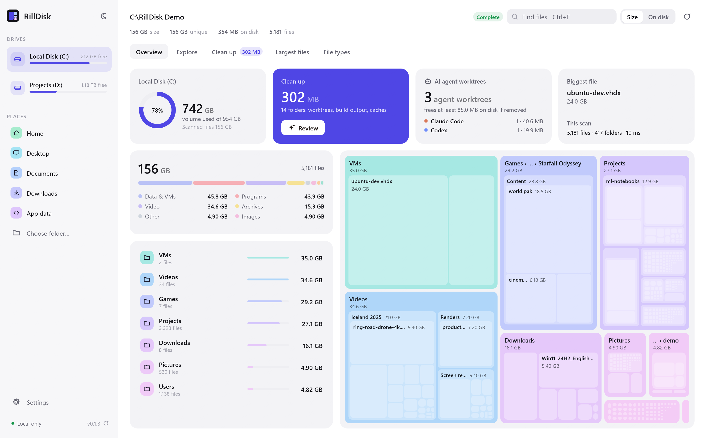
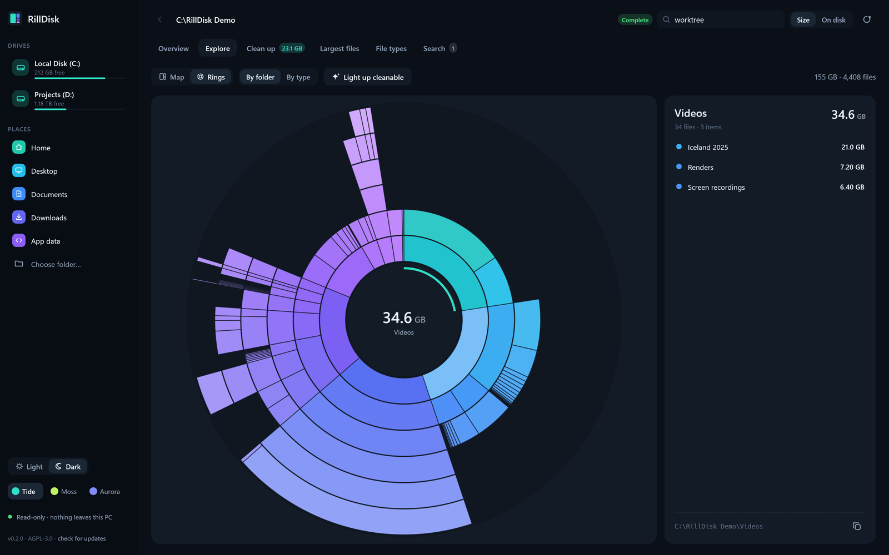
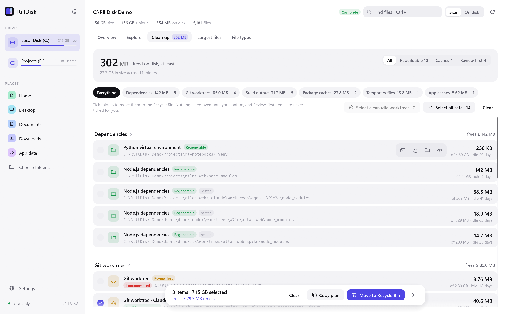
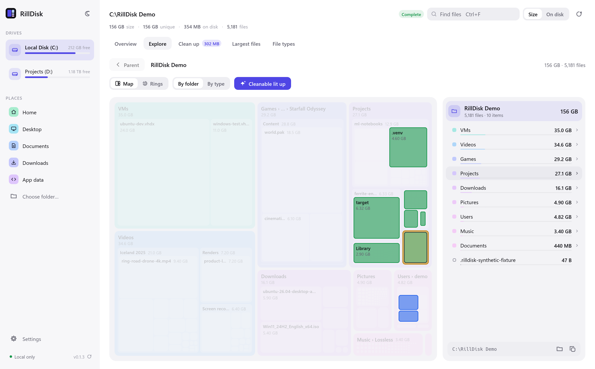
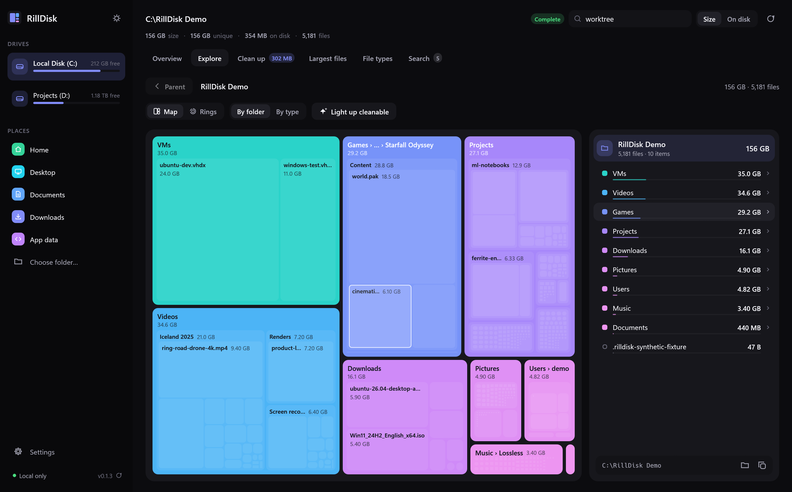

<div align="center">


# RillDisk

**See where your disk went — and what you can safely get back.**
A native, GPU-rendered disk analyzer for Windows, Linux and macOS, with a CLI and an
MCP server so your AI assistant sees exactly what you see.

[](LICENSE)


[](https://github.com/lord007tn/rilldisk/actions/workflows/ci.yml)

[Download](https://github.com/lord007tn/rilldisk/releases) ·
[Reclaim space](#reclaim-space-without-guesswork) ·
[For AI assistants](#give-your-ai-assistant-the-same-view) ·
[Performance](#performance) ·
[Roadmap](ROADMAP.md)


<sub>Recorded by the app's own scripted tour on a synthetic demo disk (<code>scripts/make_demo_fixture.py</code>) with invented drives. No real user data.</sub>

</div>

## Why RillDisk

|  |  |
| --- | --- |
| **See it at a glance** | An overview that answers the real questions first: how full the drive is, how much you can safely get back, which AI agents left worktrees behind, and the biggest file, next to a live map of the scan. |
| **Two ways to explore** | A rounded, nested treemap and a sunburst **Rings** view, both GPU-rendered (wgpu). Click to drill in, hover for details, color by folder or by file type, and light up everything that can be cleaned. |
| **Reclaim, explained** | Finds Git worktrees (including forgotten **AI-agent worktrees**, labeled Claude Code, Codex, T3 Code, Cursor or Conductor), `node_modules`, `target`, `.next`, `.venv`, Unity `Library`, package caches and temp folders. Each comes with a safety level, the reason, idle time, the exact command, and how much space it **really** frees once hard links are counted. Tick folders to build a commented **cleanup plan** you review and run yourself. |
| **Fast and lean** | Batched Win32 metadata enumeration on Windows and a no-follow `readdir` backend on Linux and macOS, on one barrier-free, work-stealing pipeline. A 3.1-million-file workspace scans in **5–9 s** using ~560 MB ([numbers](#performance)). |
| **Built for agents too** | The same engine powers a CLI with JSON output and a local **MCP server**. Claude Code, Codex, Cursor or any MCP client can scan, query and explain your disk. |
| **Yours to style** | Three color identities (**Tide**, **Moss**, **Aurora**), each in light and dark. RillDisk remembers your choice. |
| **Read-only by design** | Metadata only. Never opens, uploads or deletes files. No telemetry, no network listener, and it never elevates on its own ([how protected folders are read](docs/proposals/elevation.md)). The only network request is an [opt-out-able update check](docs/proposals/updates.md) that sends nothing about you. |
| **Open source** | AGPL-3.0-only, pure Rust: no Electron, no Tauri, no webview, no JavaScript. Windows, Linux and macOS. |

<table>
<tr>
<td width="50%"></td>
<td width="50%"></td>
</tr>
<tr>
<td><b>Overview</b> — the drive, what you can get back and where the space went.</td>
<td><b>Rings</b> — one ring per folder level; hover any slice to see what is inside.</td>
</tr>
<tr>
<td></td>
<td></td>
</tr>
<tr>
<td><b>Clean up</b> — tick folders, then copy a commented plan of the suggested commands.</td>
<td><b>Light up cleanable</b> — every candidate shown in place on the map.</td>
</tr>
<tr>
<td></td>
<td></td>
</tr>
<tr>
<td><b>Explore</b> — nested map with a live folder list beside it.</td>
<td><b>File types</b> — which kinds of files eat your space.</td>
</tr>
</table>

## Get started

Grab the package for your system from the
[latest release](https://github.com/lord007tn/rilldisk/releases/latest):

| System | Install | Get |
| --- | --- | --- |
| **Windows 10/11** (x64, ARM64) | Installer: Start menu entry, `rilldisk` on PATH, clean uninstall | `RillDisk-<version>-x64.msi` / `-arm64.msi` |
| | Portable, no admin rights | `rilldisk-<tag>-<arch>-pc-windows-msvc.zip` |
| **macOS 11+** (Apple silicon, Intel) | Drag RillDisk.app to Applications | `RillDisk-<version>-arm64.dmg` / `-x64.dmg` |
| **Debian, Ubuntu, Mint, Pop!_OS** | `sudo apt install ./rilldisk_<version>_amd64.deb` | `.deb` (amd64, arm64) |
| **Fedora, RHEL, Rocky, Alma, openSUSE** | `sudo dnf install ./rilldisk-<version>-1.x86_64.rpm` | `.rpm` (x86_64, aarch64) |
| **Any Linux desktop** (Arch, Manjaro, ...) | `chmod +x` and run; no install | `RillDisk-<version>-x86_64.AppImage` / `-aarch64` |
| **Servers, containers, Alpine** | Static CLI and MCP server, zero dependencies | `rilldisk-<tag>-<arch>-unknown-linux-musl.tar.gz` |

Linux builds run on glibc 2.28 and newer (Debian 10+, Ubuntu 20.04+, RHEL 8+).
Every release carries `SHA256SUMS` and GitHub build attestations. Builds are not
code-signed or notarized yet, so Windows SmartScreen and macOS Gatekeeper may ask
you to confirm the first launch; [docs/INSTALL.md](docs/INSTALL.md) has the steps
for each system, verification and uninstalling.

Each package holds two programs:

* **`rilldisk-desktop`** (RillDisk in your app menu): the desktop app. Pick a drive,
  a place or any folder.
* **`rilldisk`**: the CLI and MCP server.

No account, no admin rights to scan. Protected system folders are listed under
**Issues** and the result is clearly marked partial.

**Protected folders.** A normal account cannot list some system folders (on
Windows `System Volume Information`, `ProgramData\Microsoft\Windows\WER`, other
users' profiles). For full coverage, click **Restart as administrator** in the
desktop (Issues tab or header) and accept the UAC prompt; a new window rescans the
same folder. Or run the CLI from an elevated terminal. Elevated, RillDisk enables the
read-only backup privilege to list ACL-protected folders. It never changes
permissions or files. On Linux use `sudo` (the desktop offers `pkexec`); on macOS
grant **Full Disk Access**. Issues carry a `kind` (`access_denied`, `in_use`,
`not_found`, ...) and the summary an `access_denied_count`.

**Updates.** The desktop checks GitHub once a day for a newer release and offers
it; nothing is installed until you click **Install and restart**. From a terminal,
`rilldisk update --check` reports whether a newer release exists and
`rilldisk update` downloads it, verifies its SHA-256 and replaces both programs
after you confirm. Installed with the MSI, a `.deb`, an `.rpm`, the AppImage or the
`.dmg`? Then RillDisk never touches its own files: it offers the matching new
package to download instead. Both read the small `latest.yml` feed published with
every release. Set `RILLDISK_NO_UPDATE_CHECK=1` to turn update checks off entirely
([details](docs/proposals/updates.md)).

| Shortcut | Action |
| --- | --- |
| `1`–`5` | Overview, Explore, Clean up, Largest files, File types |
| `F5` / `Esc` | Rescan / stop and keep partial results |
| `Ctrl+O` / `Ctrl+F` | Scan a folder / find files by name |
| `↑ ↓` / `Enter` / `Backspace` | Move through the folder list / open / go up (mouse back too) |
| `Ctrl+C` | Copy the selected path |

**Size** shows logical file length; **On disk** shows allocated clusters with hard
links counted once. Switch at the top right.

## Reclaim space without guesswork

RillDisk recognizes folders that are rebuilt by tools, re-downloaded on demand, or
left behind by Git and AI coding agents. It decides from names, kinds and marker
files (`target` next to `Cargo.toml`, `.git` *file* in a folder, `pyvenv.cfg` in
`.venv`) — never by reading file contents — and **it never deletes anything**.

| Safety | Meaning | Examples |
| --- | --- | --- |
| 🟢 Regenerable | Rebuilt or reinstalled from source by project tooling | `node_modules`, Rust/Maven `target`, `.next`, `bin`/`obj`, `__pycache__`, `.venv`, Unity `Library`, `.terraform`, Xcode `DerivedData` |
| 🔵 Cache | Re-downloaded or recreated on demand | npm/pnpm/Yarn/pip/uv/Go/Cargo/NuGet/Gradle/Homebrew caches, Windows temp, shader caches, browser caches |
| 🟡 Review first | May hold unique work | Linked Git worktrees, orphaned agent worktrees, Recycle Bin and Trash, model downloads, `~/.cache` and `~/Library/Caches` as a whole |

```text
> rilldisk reclaim "C:\RillDisk Demo" --min-size 1GB
Reclaimable: frees at least 209.4 MiB on disk (20.5 GiB total size) in 8 candidates (>= 1.0 GiB).

      SIZE       FREES  SAFETY         IDLE  KIND                       PATH
   6.3 GiB    18.8 MiB  Regenerable      3d  Rust build output          C:\RillDisk Demo\Projects\ferrite-engine\target
                        -> cargo clean --manifest-path "C:\RillDisk Demo\Projects\ferrite-engine\Cargo.toml"
   4.6 GiB   256.0 KiB  Regenerable     20d  Python virtual environment C:\RillDisk Demo\Projects\ml-notebooks\.venv
                        -> Recreate from requirements or pyproject (python -m venv, uv sync)
   2.3 GiB     8.8 MiB  Review first   118d  Git worktree               C:\RillDisk Demo\Projects\ferrite-engine-perf
                        -> git worktree remove "C:\RillDisk Demo\Projects\ferrite-engine-perf"
...
```

<sub>The demo disk is built from sparse files, so its on-disk FREES column is small by
design. On real disks SIZE and FREES differ when files are hard-linked or sparse (a
sparse file frees only its allocated blocks).</sub>

**Why FREES matters.** pnpm, Cargo and others hard-link files, so a folder can look
huge while its data also lives elsewhere. RillDisk tracks file identity and reports
the space that removing a folder actually frees, counting every hard link it found
in the scan (scan the whole drive for the most accurate figure). On the
maintainer's machine, 112 agent worktrees totaled 268 GB on paper but would free
64 GB; RillDisk says so up front. The desktop shows the same split
("frees ≥ … · … hard-linked").

Suggested commands paste as-is into PowerShell or Git Bash, and Git itself refuses
to remove a worktree that has uncommitted changes. Worktrees created by Claude Code, Codex, T3 Code, Cursor or Conductor are labeled
with their owner. Folders left in an agent's `worktrees` directory **without** a
`.git` are flagged as *orphaned*: Git no longer knows them, so `git worktree remove`
cannot help and they silently keep their full `node_modules`. Totals never double
count nested candidates.

## Give your AI assistant the same view

`rilldisk mcp` is a local stdio MCP server. Give it explicit roots; it cannot reach
anything outside them.

```json
{
  "mcpServers": {
    "rilldisk": {
      "command": "C:\\Tools\\RillDisk\\rilldisk.exe",
      "args": ["mcp", "--root", "C:\\Users\\YourName"]
    }
  }
}
```

Claude Code: `claude mcp add rilldisk -- C:\Tools\RillDisk\rilldisk.exe mcp --root C:\Users\YourName`

| Tool | What it does |
| --- | --- |
| `allowed_roots` | Configured scope and limits |
| `start_scan` / `scan_status` / `cancel_scan` | Background scan with live progress; partial results stay queryable |
| `query_entries` | Browse children, largest files, or search paths; paginated |
| `find_reclaimable` | Worktrees, build output, dependencies and caches with safety, reason, idle days and suggested command |
| `file_types` | Space by extension |

Then ask: *"Find what's eating space in my projects folder, and give me a cleanup
plan sorted by safety."* The server exposes no delete, move, shell or content-read
tool; your assistant proposes, you decide. Paths are treated as untrusted data.
See [docs/MCP.md](docs/MCP.md).

Everything is scriptable from the CLI too:

```powershell
rilldisk drives                                  # capacity and free space
rilldisk scan D:\ --top 30                       # largest files
rilldisk scan D:\ --format jsonl -o inventory.jsonl
rilldisk reclaim $HOME --format json             # machine-readable cleanup candidates
```

Exit status: `0` complete, `2` partial, `130` cancelled, `1` failure. Output files
must be new; existing files are never overwritten.

## Performance

Measured November 1, 2026 on Windows 11, Intel Core Ultra 9 285HX, 64 GB RAM,
2 TB NVMe, ordinary user privileges, release build, default settings, on a busy
workstation (other agents and WSL running), so ranges are shown.

| Dataset | Entries | Scan time | Peak memory |
| --- | ---: | ---: | ---: |
| Synthetic 50,000 files (`scripts/benchmark.py`, 8 threads) | 50,000 | **24 ms** scanner median (first prototype: 62 ms) | — |
| Developer workspace, warm | 3.13M files / 404k folders | **4.6–8.9 s** (first prototype: 14.5 s) | **~560 MB** |
| Whole user profile (`C:\Users`) | 18.0M files / 1.9M folders | **92 s** (barrier-based build: 422 s) | — |
| Entire system drive (`C:\`) | 27.0M files / 2.9M folders | **177 s** | — |

What changed since the first prototype:

* **No barriers.** Workers queue subfolders the moment they read them; a single
  coordinator only assigns IDs. One slow folder no longer stalls a whole group. If
  the whole scan makes no progress for 60 s (a stuck network or cloud provider),
  the outstanding folders are reported and the scan finishes with what it found.
* **Half the memory.** Entries store only their name; paths are rebuilt from the
  parent chain on demand. About 160 bytes per entry, down from about 357.
* **Less work per folder.** Volume identity is read once per scan, names are
  allocated on worker threads, and hard-link tracking uses a cheap hash.

**Linux** (WSL2 Ubuntu on the same machine, ext4, warm cache, release build): the
50,000-file synthetic benchmark has a **12 ms** scanner median with 8 threads, and
`/usr` (36,589 files, 4,510 folders) scans in **~24 ms** with counts identical to
`find -xdev`. macOS is built and tested in CI but not yet measured. Details:
[docs/PERFORMANCE.md](docs/PERFORMANCE.md#linux-wsl2-observation).

RillDisk is **not yet** an MFT reader, so it does not claim WizTree-level
whole-volume speed; a qualified NTFS fast path is [on the roadmap](ROADMAP.md).
Method and earlier comparisons: [docs/PERFORMANCE.md](docs/PERFORMANCE.md).

## Accuracy you can trust

* **Three sizes, never mixed.** Logical bytes per name, unique bytes per file
  identity (hard links once), and allocated bytes. Sparse and resident NTFS files
  report what they really occupy, and every name of a hard-linked file is flagged.
* **Partial is visible.** Unreadable folders, cancellation, unresponsive folders and
  the entry limit (30 million by default, `--max-entries`) mark the result partial
  everywhere: the status chip, CLI exit code, JSON and MCP.
* **No surprises.** Junctions, symlinks and cloud placeholders are listed but not
  followed or hydrated. On Linux and macOS a scan stays on one filesystem: other
  mounts are listed, not entered, and counted as `skipped_mounts`
  (`--cross-filesystems` includes real disks; `/proc`, `/sys`, `/dev` and `/run`
  never are).

Allocated totals are file allocations, not total volume usage: filesystem metadata,
alternate streams and directory overhead are excluded. Scans are live, not atomic
snapshots.

## Build from source

Windows (x64 or ARM64) with [Rust stable](https://rustup.rs/), Visual Studio C++
Build Tools and the Windows SDK (its `rc.exe` embeds the icon, version details and
manifest; set `RC_PATH` if the build cannot find it):

```powershell
cargo build --release --locked
.\target\release\rilldisk-desktop.exe
.\target\release\rilldisk.exe reclaim $HOME
```

Linux and macOS with Rust stable and a C toolchain (Xcode Command Line Tools on
macOS). The desktop needs no extra libraries on macOS; on Linux, CI installs
`pkg-config libxkbcommon-dev libwayland-dev libx11-dev` (the X11 session also loads
`libxkbcommon-x11` at runtime):

```sh
cargo build --release --locked
./target/release/rilldisk drives
./target/release/rilldisk reclaim ~
./target/release/rilldisk-desktop
```

The workspace has four crates: `rilldisk-core` (scanner, accounting, reclaim
rules), `rilldisk` (CLI + MCP), `rilldisk-desktop` (egui + wgpu) and
`rilldisk-update` (the only network code: opt-in update checks). CLI and MCP
builds carry no renderer dependencies. See [architecture](docs/ARCHITECTURE.md).

```powershell
cargo fmt --all -- --check
cargo clippy --workspace --all-targets --locked -- -D warnings
cargo test --workspace --locked
python scripts/test_mcp.py target/release/rilldisk.exe
python scripts/make_demo_fixture.py "C:\RillDisk Demo"       # synthetic demo disk
target\release\rilldisk-desktop.exe "C:\RillDisk Demo" --capture shots   # screenshots + frames
```

Release archives and installers (MSI, `.deb`, `.rpm`, AppImage, `.dmg`) are built by
`scripts/package_release.py` and `scripts/package_installers.py`; the
[release workflow](.github/workflows/release.yml) runs them for all eight targets
and installs each package before publishing. See
[docs/INSTALL.md](docs/INSTALL.md#building-the-packages).

Contributions are welcome — see [CONTRIBUTING.md](CONTRIBUTING.md). Security
reports: [SECURITY.md](SECURITY.md).

## License

Copyright © 2026 Raed Bahri and RillDisk contributors. Licensed under the
[GNU Affero General Public License v3.0 only](LICENSE).
