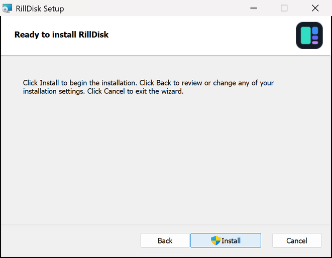

# Installing RillDisk

Every release on the [releases page](https://github.com/lord007tn/rilldisk/releases/latest)
has a package for each system below. Each holds the same two programs:
**RillDisk** (`rilldisk-desktop`, the desktop app) and `rilldisk` (the CLI and
local MCP server). Scanning never needs administrator rights.

| System | Package | Architectures |
| --- | --- | --- |
| [Windows 10 and 11](#windows) | `.msi` installer or portable `.zip` | x64, ARM64 |
| [macOS 11 Big Sur and newer](#macos) | `.dmg` with RillDisk.app, or `.tar.gz` | Apple silicon, Intel |
| [Debian, Ubuntu and derivatives](#debian-ubuntu-mint-pop_os-elementary) | `.deb` | amd64, arm64 |
| [Fedora, RHEL, Rocky, Alma, openSUSE](#fedora-rhel-rocky-alma-opensuse) | `.rpm` | x86_64, aarch64 |
| [Any Linux desktop](#any-linux-appimage) | `.AppImage` | x86_64, aarch64 |
| [Any Linux, no package](#any-linux-tarball) | `.tar.gz` (glibc 2.28+) | x86_64, aarch64 |
| [Servers, containers, Alpine](#servers-containers-and-alpine) | static `.tar.gz`, CLI only | x86_64, aarch64 |

Linux builds need glibc 2.28 or newer: Debian 10+, Ubuntu 20.04+, RHEL, Rocky and
Alma 8+, any current Fedora, openSUSE or Arch. The static (musl) build runs
anywhere, including Alpine.

## Windows

**Installer.** Download `RillDisk-<version>-x64.msi` (or `-arm64.msi` on
Windows on ARM) and open it. It installs to `C:\Program Files\RillDisk`, adds
RillDisk to the Start menu and puts `rilldisk` on the PATH for new terminals.
Windows asks for administrator approval to install to Program Files. Uninstall
from **Settings > Apps > Installed apps**.



**Portable.** Download `rilldisk-<tag>-x86_64-pc-windows-msvc.zip` (or
`aarch64-pc-windows-msvc`), extract it anywhere and run `rilldisk-desktop.exe`.
No installation and no admin rights. Delete the folder to remove it.

The builds are not code-signed yet, so SmartScreen may say "Windows protected
your PC". Choose **More info**, then **Run anyway**.

## macOS

Download `RillDisk-<version>-arm64.dmg` (Apple silicon) or `-x64.dmg` (Intel),
open it and drag **RillDisk** to **Applications**.

The app is not notarized yet, so the first launch is blocked. Open
**System Settings > Privacy & Security**, scroll to the message about RillDisk and
choose **Open Anyway**. Or, from Terminal:

```sh
xattr -dr com.apple.quarantine /Applications/RillDisk.app
```

macOS asks before RillDisk reads Desktop, Documents, Downloads or external
drives. To scan your whole disk without prompts, add RillDisk under **Privacy &
Security > Full Disk Access**. RillDisk reads names and sizes only, never file
contents.

The CLI is inside the app. To use it from a terminal:

```sh
sudo mkdir -p /usr/local/bin
sudo ln -sf /Applications/RillDisk.app/Contents/MacOS/rilldisk /usr/local/bin/rilldisk
```

Prefer no app bundle? `rilldisk-<tag>-aarch64-apple-darwin.tar.gz` (or
`x86_64-apple-darwin`) holds both programs; run `xattr -dr com.apple.quarantine .`
in the extracted folder once.

## Debian, Ubuntu, Mint, Pop!_OS, elementary

```sh
sudo apt install ./rilldisk_<version>_amd64.deb    # arm64: rilldisk_<version>_arm64.deb
```

RillDisk appears in your app menu; `rilldisk` is on the PATH. Remove it with
`sudo apt remove rilldisk`.

## Fedora, RHEL, Rocky, Alma, openSUSE

```sh
sudo dnf install ./rilldisk-<version>-1.x86_64.rpm      # aarch64: ...-1.aarch64.rpm
sudo zypper install ./rilldisk-<version>-1.x86_64.rpm   # openSUSE
```

Remove it with `sudo dnf remove rilldisk` (or `sudo zypper remove rilldisk`).

## Any Linux: AppImage

```sh
chmod +x RillDisk-<version>-x86_64.AppImage
./RillDisk-<version>-x86_64.AppImage
```

Works on Arch, Manjaro, Gentoo, Void and anything else with a desktop. AppImages
need FUSE; if yours lacks it, run with `--appimage-extract-and-run`. The CLI is
inside: `./RillDisk-<version>-x86_64.AppImage --appimage-extract` unpacks it to
`squashfs-root/usr/bin/rilldisk`. AppImageUpdate and AppImageLauncher can update
it using the published `.zsync` file.

## Any Linux: tarball

```sh
tar xzf rilldisk-<tag>-x86_64-unknown-linux-gnu.tar.gz
cd rilldisk-<tag>-x86_64-unknown-linux-gnu
./rilldisk-desktop
```

This copy updates itself with `rilldisk update`.

## Servers, containers and Alpine

`rilldisk-<tag>-x86_64-unknown-linux-musl.tar.gz` (or `aarch64`) is a single
static `rilldisk` with no dependencies: the CLI and the MCP server, no desktop app.

```sh
tar xzf rilldisk-<tag>-x86_64-unknown-linux-musl.tar.gz
sudo install rilldisk-<tag>-x86_64-unknown-linux-musl/rilldisk /usr/local/bin/
rilldisk reclaim /srv
```

## The desktop app on Linux

The desktop app draws with your GPU through Vulkan or OpenGL (EGL) and opens a
Wayland or X11 window. Desktop distributions have everything installed already;
the `.deb` and `.rpm` list these libraries as recommended packages. On a minimal
system, install them yourself:

```sh
sudo apt install libegl1 libvulkan1 libxkbcommon-x11-0 libwayland-client0    # Debian, Ubuntu
sudo dnf install mesa-libEGL vulkan-loader libxkbcommon-x11 libwayland-client # Fedora, RHEL
```

The folder picker uses the XDG desktop portal (`xdg-desktop-portal`), which
every mainstream desktop provides.

## Verify a download

Every release lists the SHA-256 of each file in `SHA256SUMS` and in `latest.yml`,
and GitHub signs a build-provenance attestation for every file:

```sh
sha256sum --check --ignore-missing SHA256SUMS
gh attestation verify RillDisk-<version>-x64.msi --repo lord007tn/rilldisk
```

On Windows: `Get-FileHash .\RillDisk-<version>-x64.msi` and compare with
`SHA256SUMS`.

## Updates

| Installed with | How it updates |
| --- | --- |
| `.zip` / `.tar.gz` | `rilldisk update`, or **Install and restart** in the app. Verified with SHA-256, both programs replaced. |
| `.msi` | The app and `rilldisk update --check` link the new `.msi`; run it to upgrade in place. |
| `.deb` / `.rpm` | They link the new package; install it with `apt` / `dnf` / `zypper` as above. |
| AppImage | They link the new AppImage; replace the old file (or use AppImageUpdate). |
| `.dmg` | They link the new `.dmg`; drag the new RillDisk over the old one. |

RillDisk never replaces files that an installer or package manager owns, and it
never runs an installer itself. The desktop checks for updates once a day if
you allow it; set `RILLDISK_NO_UPDATE_CHECK=1` to turn every check off. Details:
[proposals/updates.md](proposals/updates.md).

## Building the packages

Archives come from `scripts/package_release.py package`, installers from
`scripts/package_installers.py` (`msi`, `linux`, `macos`), and
`scripts/package_release.py finalize` writes `SHA256SUMS`, `BUILD-MANIFEST.json`
and `latest.yml`. The tools each needs are listed at the top of
`package_installers.py`; the [release workflow](../.github/workflows/release.yml)
shows the exact, pinned versions. Packaging assets (WiX source, desktop entry,
AppStream metadata, Info.plist, icons) live in [`packaging/`](../packaging);
icons are rendered by `scripts/make_icons.py` from the same geometry as
[the logo](media/logo.svg).
