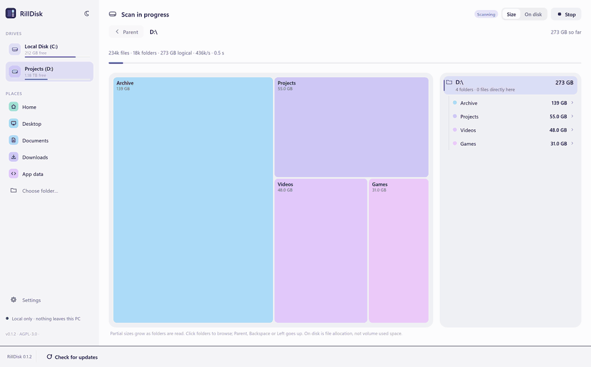
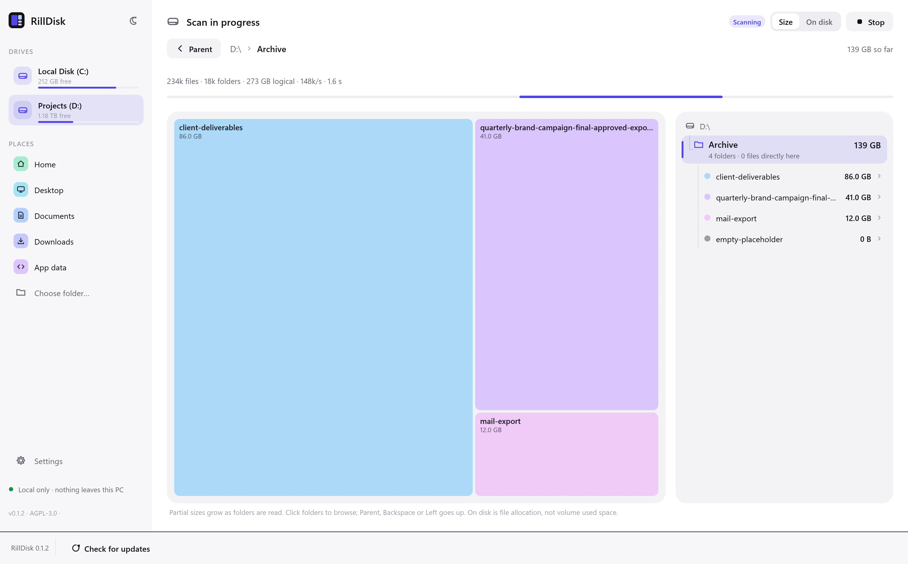
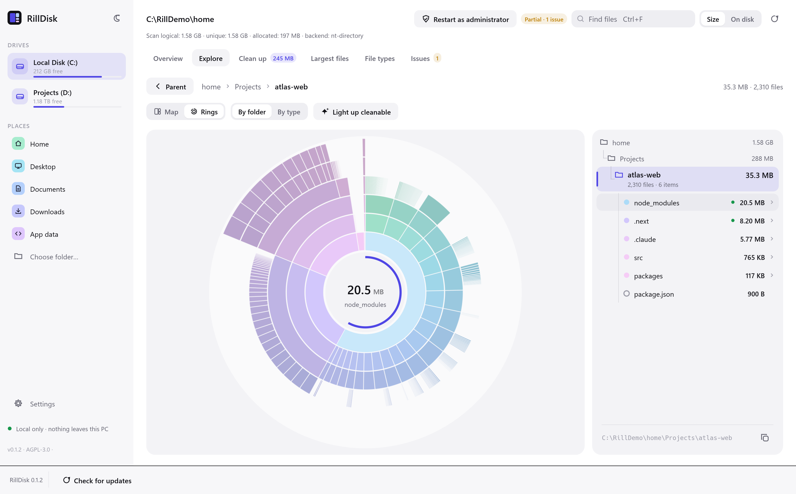
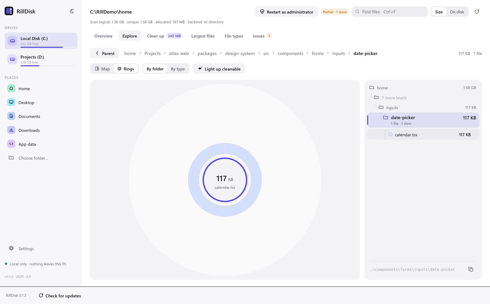
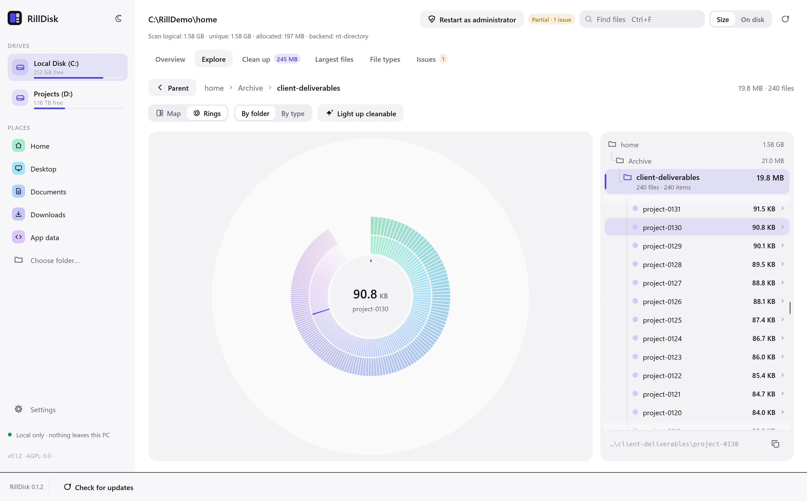
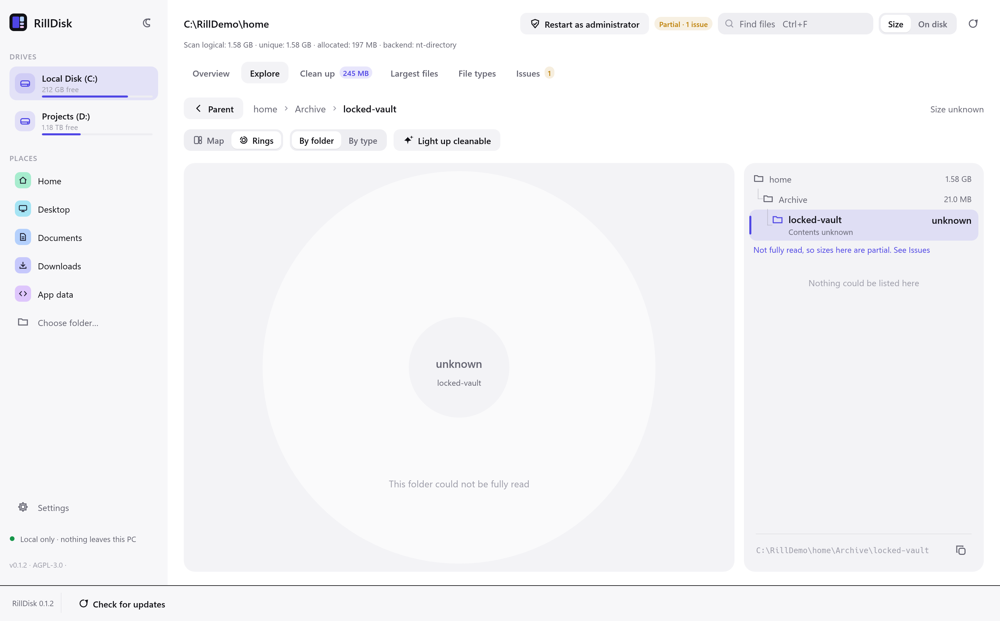
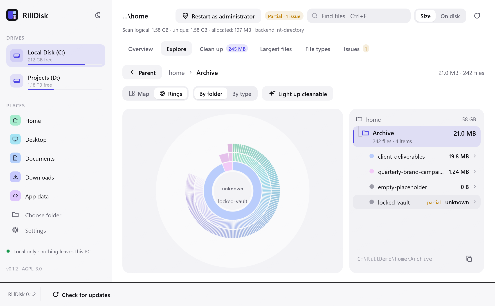
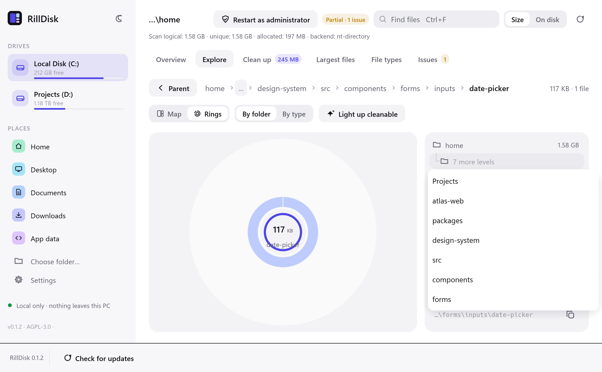
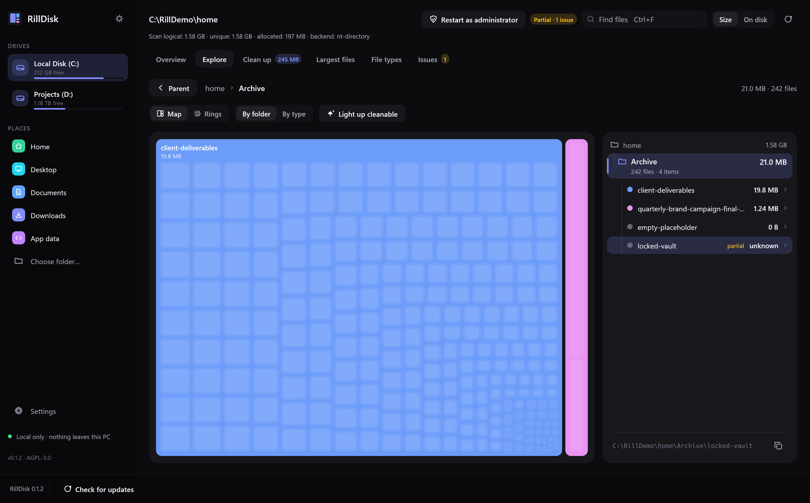

# Folder navigation

Explore and the live scan dashboard share one location bar and folder panel
(`crates/rilldisk-desktop/src/app/nav.rs`), so finished results and running scans
are browsed the same way.

| To | Do |
|---|---|
| Open a folder | Click its row or tile, or `Enter` on the selected row |
| Go up one level | **Parent**, `Backspace`, `←` or mouse back |
| Jump to any level | A breadcrumb or trail row; **…** and **N more levels** list the hidden ones |
| Move through the list | `↑` `↓`, or scroll |

- The panel always lists the shown folder. Hovering the chart highlights the
  matching row and leaves the list where it is.
- After going up, the folder you left is marked and scrolled into view.
- Every child is listed, including empty folders and zero-byte files, so the item
  count, the list and arrow keys agree.
- A folder that listed nothing shows `unknown`, not `0 B`, and links to Issues. A
  partly read folder is marked `partial`. On disk shows `unknown` when allocation
  was not measured.
- A new scan shows its live dashboard on any tab; its navigation keys work there.
  During a rescan or after completion, going up applies only to Explore. A rescan
  keeps your folder, or reports that it is absent from the new results (which may
  be partial).

## Evidence

All media is fictional: `scripts/make_demo_fixture.py` and
`scripts/make_navigation_fixture.py` scanned from `C:\RillDemo\home`, with the
synthetic drive list used by every capture. Pointer, wheel and key events are
injected as ordinary egui input.



| | |
|---|---|
|  Browsing a running scan (scripted views) |  Trail, current folder and children |
|  Chart hover keeps the list |  Ten levels deep |
|  Returning marks the row left |  An unreadable folder |
|  Long names, 1100×680 |  Hidden levels, 1100×680 |
|  Dark theme | |

Reproduce:

```text
python scripts/make_demo_fixture.py C:\RillDemo\home --scale 0.01
python scripts/make_navigation_fixture.py C:\RillDemo\home
rilldisk-desktop C:\RillDemo\home --capture OUTPUT --tour navigation --theme light
python scripts/make_navigation_fixture.py C:\RillDemo\home --unlock
```

The tour asserts every step and stops on a failed one. Add `--size 1100x680` for the
minimum window. `cargo test -p rilldisk-desktop` drives the whole app with the same
kinds of events.

## Limits

- The live steps show scripted `LiveView`s through the real dashboard and input
  handling. The fixture scans in under a second, too fast to record. Publishing
  during real scans is covered by the core tests, so the "Opening folder…" state,
  seen only between a click and the next publication, is not in the recording.
- MFT scans publish no folders until the table is processed, so there is nothing to
  browse before then.
- The panel shows the partial marker on the folder itself, not on its ancestors.
- Mouse back goes up a level; there is no back/forward history.
- Tab stops after the header search field and wraps to the start, so it does not
  reach the tabs, location bar or folder rows. Arrow keys, `Enter` and `Backspace`
  work without Tab, unless Tab has focused a control: press `Esc` to release it.
  Rows, trail and breadcrumbs do report their names to assistive technology.
- Scan speed is unchanged. The six-minute whole-drive report in
  [PERFORMANCE-INVESTIGATION.md](PERFORMANCE-INVESTIGATION.md) remains unresolved.
