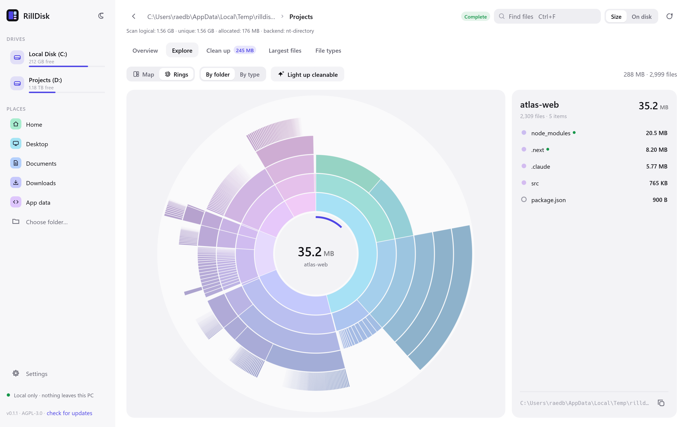
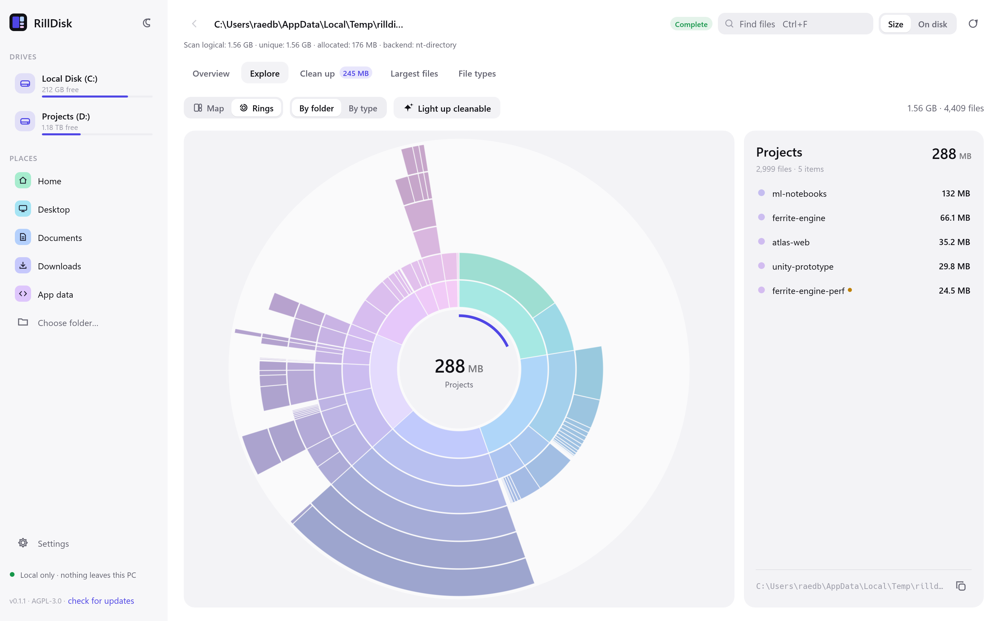
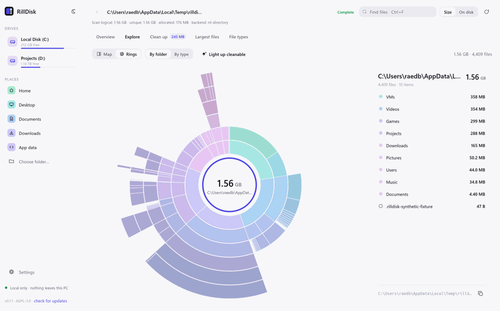

# RillDisk 0.1.1

- Browse discovered folders during scans, with clickable maps and a scrollable
  complete folder list. Use Parent, breadcrumbs, Backspace or mouse Back.
- Folder clicks in completed charts enter Explore, keeping Parent and the shown
  folder consistent. Keep the live folder open when results finish.
- Distinguish logical, unique and allocated file totals from volume used space.
  Exact bytes are available on hover; partial results remain visible.
- Show the chosen scan backend and the reason Auto could not use NTFS MFT.
- Reduce Windows directory-parser temporary allocations. The synthetic parser
  benchmark improved 17.6%; a whole-scan speedup has not been demonstrated.
- Fix the Windows core dependency features required for standalone desktop builds.

See [the investigation](PERFORMANCE-INVESTIGATION.md) for measurements, algorithm
costs and limits. This update does not claim that the reported six-minute scan
has been solved. Release packages and update feeds use version 0.1.1, built by
the existing tag-triggered release workflow after merge and CI acceptance.

## Verification media

Fictional demo fixture; native UI pointer/key events, with assertions that the
folder opens and Backspace returns to the root. The live-map click also has an
egui input regression test; the short fixture completes before live navigation
can be recorded. No personal scan inventory is included.

Reproduce with `python scripts/make_demo_fixture.py PATH --scale 0.01`, then
`rilldisk-desktop PATH --capture OUTPUT --tour navigation --theme light`.
